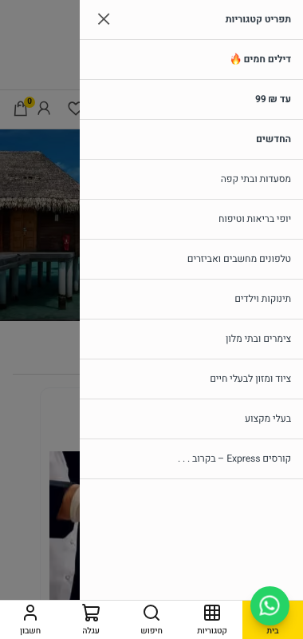
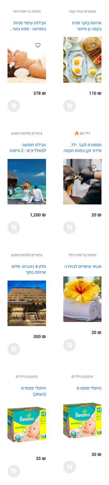
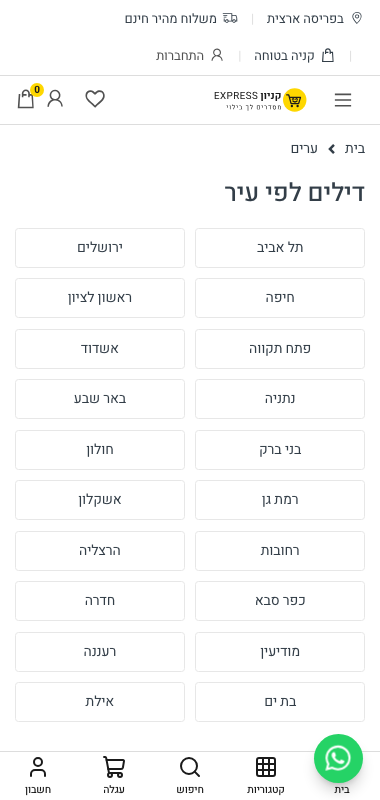
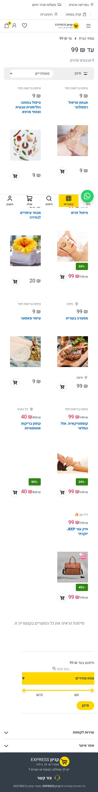
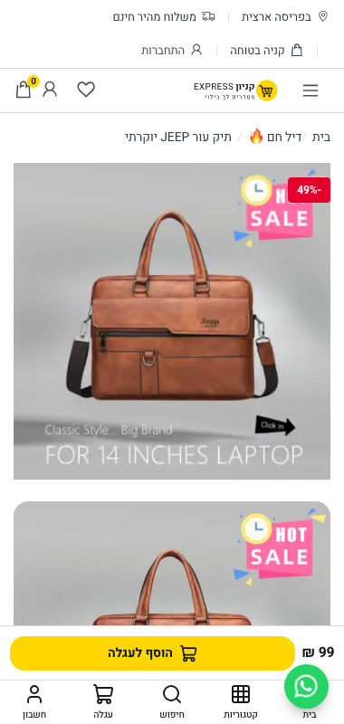

# C145 — MOBILE + PWA

Date: 2026-11-02. Branch closeout/v1-final. Local prod build (`next build` exit 0, `next start -p 3318`), live Supabase.
Mobile reference: Electro v7 (refs/electro-home-v7.html: product grids are `row-cols-2` at the base breakpoint). No WordPress layout used.

## What changed
| Area | Before | After |
|---|---|---|
| PWA icons | generated from Electro `ec-shopping-bag.svg` (C10) | `scripts/generate-pwa-icons.mjs` renders the cart mark from the upgraded logo `public/images/logo.svg` (C137): 192/512 any, 192/512 maskable (80% safe zone), 180 apple-touch |
| Manifest | 1 maskable icon | + `icon-maskable-192.png` |
| iOS splash | 9 launch screens from old 133x102 `public/logo.png` at 40% | regenerated from `logo.svg` at 60% width, vector-rendered per device density |
| Install prompt | shown on 3rd **page view** (`ke:views`) | shown on 3rd **visit** (`ke:visits` + per-session `ke:visit-counted`; reloads/navigation within a visit don't count) |
| Hamburger drawer | panel had no background (`bg-drawer` → nonexistent token), menu text painted over the page | `bg-drawer-bg` (`--color-drawer-bg`), opaque panel |
| Sticky bottom buy bar (PDP) | 99 ₪ product showed **‏0.99 ₪** (shekels passed to an agorot prop, decimals allowed) | `agorotFromIlsNumber(basePrice)` from money.ts + `maximumFractionDigits: 0` → ‏99 ₪ |
| Card grid 380 | home featured grid `grid-cols-1`; /category grid 1 column ≤575px | 2 columns (`grid-cols-2`; `.category-products__item` 50% at ≤575 in all view modes) |
| Push icon | `/icon-192x192.png` (404) | `/icons/icon-192.png` |

Already present and verified, not changed: sticky bottom nav `MobileNavBar` (בית/קטגוריות/חיפוש/עגלה/חשבון), service worker `public/sw.js`, Web Share (`NativeShareButton` + WhatsApp share on PDP), offline shell.
Forbidden files: none touched (src/app/layout.tsx, header/hero/topbar untouched; iOS startup images stay in `(store)/layout.tsx`).

## Gate 1: Lighthouse PWA installable — PASS
Lighthouse 13 has no PWA category (removed in v12), so the PWA category was run with Lighthouse 11.7.1:
`npx -y lighthouse@11.7.1 http://localhost:3318/ --only-categories=pwa --form-factor=mobile --screenEmulation.mobile --chrome-path=<playwright chromium> --chrome-flags="--headless=new" --output=json`
```
lighthouse 11.7.1 url http://localhost:3318/
pwa-installable installable-manifest 1 binary
pwa-optimized splash-screen 1 binary
pwa-optimized themed-omnibox 1 binary
pwa-optimized content-width 1 binary
pwa-optimized viewport 1 metricSavings
pwa-optimized maskable-icon 1 binary
- pwa-cross-browser null manual
- pwa-page-transitions null manual
- pwa-each-page-has-url null manual
pwa category score 1
```
Full report: docs/C145/lh-pwa-home.json

Chrome DevTools Protocol check (`/tmp/c145/install.mjs`, persistent non-incognito profile, 380x800 mobile):
```
manifest url: http://localhost:3318/manifest.webmanifest
manifest errors: []
manifest name/display/start_url: קניון EXPRESS standalone /
manifest icons: [{"src":"/icons/icon-192.png","sizes":"192x192","type":"image/png","purpose":"any"},{"src":"/icons/icon-512.png","sizes":"512x512","type":"image/png","purpose":"any"},{"src":"/icons/icon-maskable-192.png","sizes":"192x192","type":"image/png","purpose":"maskable"},{"src":"/icons/icon-maskable-512.png","sizes":"512x512","type":"image/png","purpose":"maskable"}]
service worker: {"scope":"http://localhost:3318/","script":"http://localhost:3318/sw.js","controlled":true,"controlledAfterReload":true}
installabilityErrors: []
iOS head: {"appleTouch":"/icons/apple-touch-icon.png","startup":9,"capable":"yes"}
product share controls: ["שתפו בוואטסאפ"] navigator.share: undefined
sticky bar text: ‏99 ‏₪
הוסף לעגלה
```

## Gate 2: unit tests / types / lint
```
$ npx tsc --noEmit  -> exit 0
$ npx vitest run src/components/layout src/components/mobile src/components/pwa src/components/home src/components/category src/components/storefront src/app src/lib/pwa src/lib/push src/lib/money
 Test Files  168 passed (168)
      Tests  1422 passed (1422)
$ npx biome check <30 changed files>  -> Checked 30 files in 40ms. No fixes applied.
$ node scripts/tokens-gate.mjs -> tokens gate: clean (no raw hex, rgb() or arbitrary px in src/)
$ node scripts/asset-gate.mjs  -> asset gate: clean (no template or vendor product imagery under public/images)
```
New tests: install-prompt "counts each visit and offers the install on the third", "does not count page loads within one visit"; StickyCartBar "never shows agorot"; ProductStickyCartBar 99 ₪ not 0.99.

## Gate 3: compare.mjs < 11% — FAIL (locked components)
`COMPARE_ALLOW_PENDING_IMAGES=1 LOCAL_BASE=http://localhost:3318 node scripts/compare.mjs --page=<p> --width=<w>`
```
=== home 380
OVERALL first 2600px: 44.87%
  of which: reference blank 16.67%  ours blank 13.86%  both painted 14.33%
=== home 768
OVERALL first 2600px: 40.59%
  of which: reference blank 16.93%  ours blank 14.37%  both painted 9.29%
=== home 1440
OVERALL first 2600px: 27.56%
  of which: reference blank 12.03%  ours blank 8.37%  both painted 7.16%
=== product 380
OVERALL first 2600px: 42.23%
  of which: reference blank 30.24%  ours blank 7.19%  both painted 4.8%
=== product 768
OVERALL first 2600px: 31.11%
  of which: reference blank 18.73%  ours blank 6.96%  both painted 5.42%
=== product 1440
OVERALL first 2600px: 18.99%
  of which: reference blank 10.96%  ours blank 5.49%  both painted 2.53%
=== category 380
OVERALL first 2600px: 29.52%
  of which: reference blank 9.17%  ours blank 16.43%  both painted 3.91%
=== category 768
OVERALL first 2600px: 29.76%
  of which: reference blank 8.13%  ours blank 19.58%  both painted 2.05%
=== category 1440
OVERALL first 2600px: 17.54%
  of which: reference blank 4.68%  ours blank 12.13%  both painted 0.72%
```
Home 380 bands (same run):
```
all bands:
  y    0   60.5%  ##############################
  y  100   62.4%  ###############################
  y  200    100%  ##################################################
  y  300   98.2%  #################################################
  y  400    7.9%  ####
  y  500   31.7%  ################
  y  600   67.7%  ##################################
  y  700   69.7%  ###################################
  y  800   32.5%  ################
  y  900   11.1%  ######
  y 1000     31%  ################
  y 1100   21.6%  ###########
  y 1200   59.8%  ##############################
  y 1300   18.3%  #########
  y 1400   12.1%  ######
  y 1500   38.1%  ###################
  y 1600   75.7%  ######################################
  y 1700   20.2%  ##########
  y 1800   53.4%  ###########################
  y 1900   66.8%  #################################
  y 2000   73.2%  #####################################
  y 2100   14.9%  #######
  y 2200     22%  ###########
  y 2300   46.9%  #######################
  y 2400   38.9%  ###################
  y 2500   31.9%  ################
```
Bands 0-400 (TopBar + MainHeader + HeroSection, all locked) average (60.5+62.4+100+98.2)/4 = 80.3% over 400 of 2600 px = **12.35 pt of the overall on their own**, above the 11% gate before any editable band counts. Same finding as C138 (12.34 pt). Home 380 moved 45.72 → 44.87, category 380 30.49 → 29.52 vs C138.

## Screenshots (380px, consent dismissed)
- Home: 
- Hamburger drawer open: 
- Home featured cards, 2 columns: 
- /c: 
- /category/under-99, 2-column grid + bottom bar: 
- Product, sticky buy bar ‏99 ₪ above bottom nav: 
- Icons:  
- iOS splash 1170x2532: 

## RESULT
PWA installable gate and mobile layout pass; compare.mjs gate is above 11% because of locked-component bands.

RESULT: BLOCKED locked-component C145 compare.mjs home380 44.87 (locked bands 0-400 = 12.35pt) ; LH PWA installable PASS
